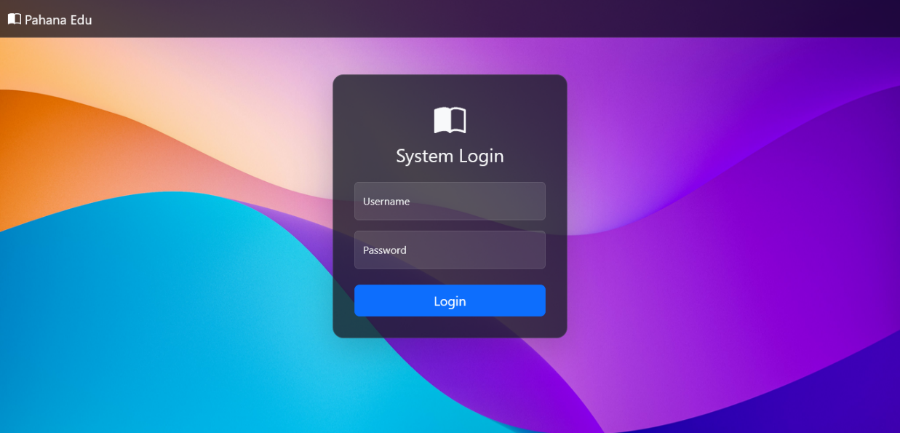
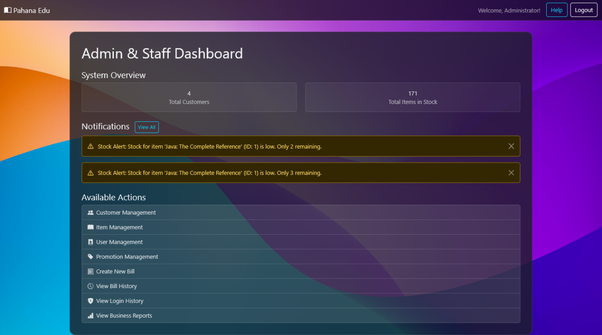
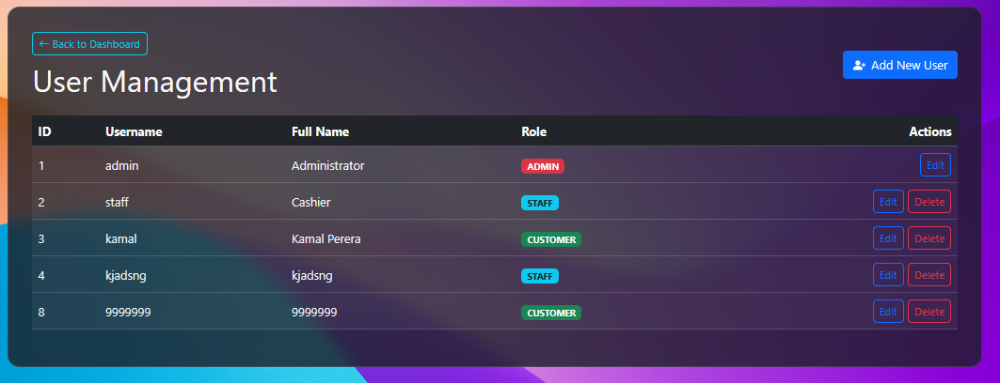
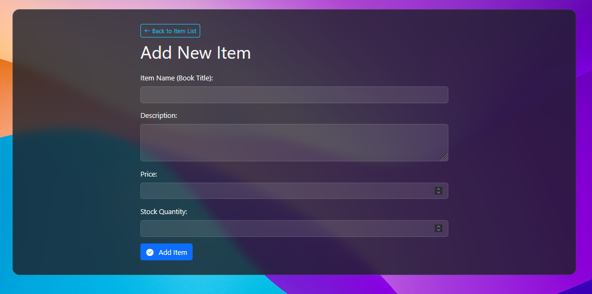
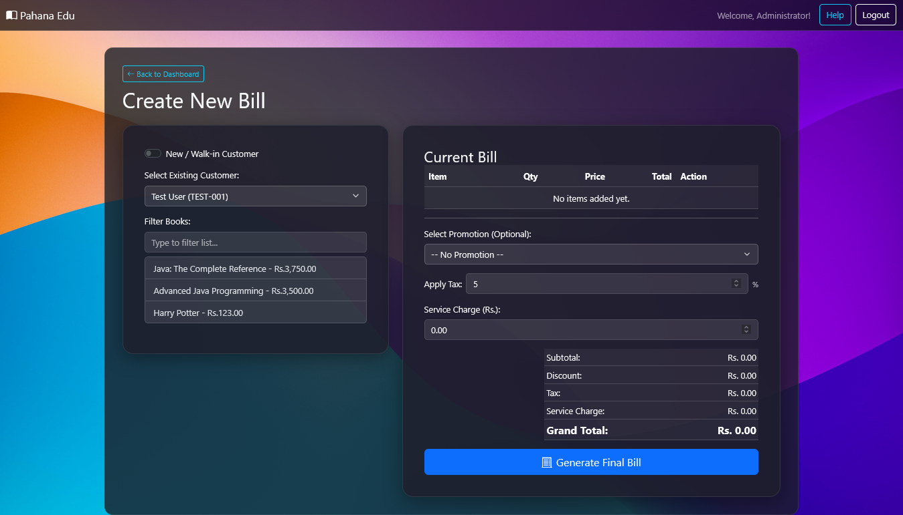
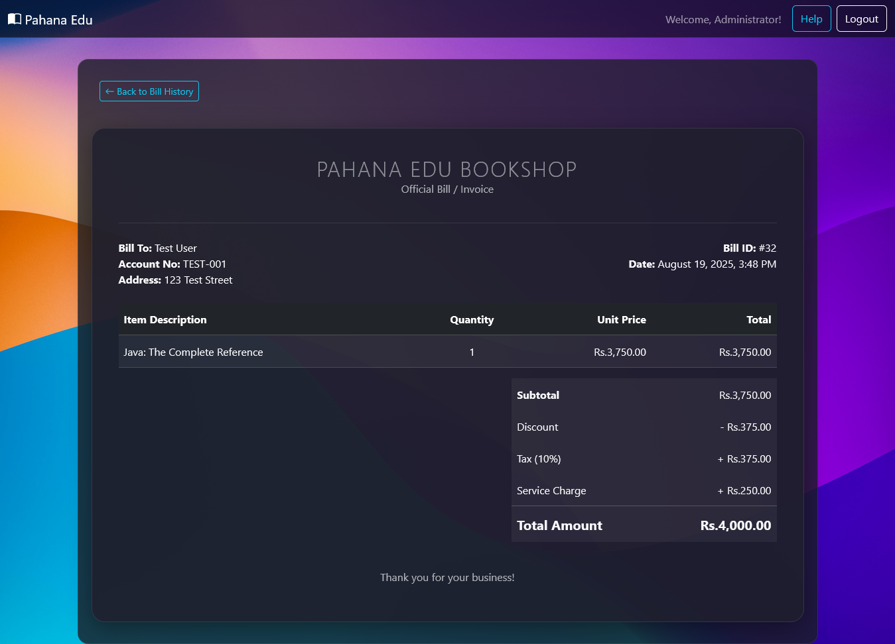

# Pahana Edu - Online Billing System

## Project Overview

This project is a comprehensive, web-based online billing system for **Pahana Edu Bookshop**, developed as a primary assessment for the Advanced Programming module (CIS6003). The application is built using Java Enterprise Edition (Java EE) technologies, follows a robust 3-Tier MVC architecture, and adheres to modern software engineering principles like SOLID and Test-Driven Development (TDD).

The system allows Admins and Staff to manage users, customers, inventory, and promotions, while providing a dedicated portal for customers to view their purchase history.

---

## Screenshots

The application as it looked when I submitted it (pictures from my assignment report, August 2025).

<table>
  <tr>
    <td width="50%"> Login</td>
    <td width="50%"> Admin and staff dashboard, with low-stock notices</td>
  </tr>
  <tr>
    <td width="50%"> User management</td>
    <td width="50%"> Add a new item</td>
  </tr>
  <tr>
    <td width="50%"> Create a bill: customer, items, promotion, tax and service charge</td>
    <td width="50%"> The generated invoice</td>
  </tr>
</table>

## 🚀 Technology Stack

This project utilizes a full-stack, industry-standard set of technologies:

| Layer       | Technology                                                                                                                                  | Purpose                                                                               |
| :---------- | :------------------------------------------------------------------------------------------------------------------------------------------ | :------------------------------------------------------------------------------------ |
| **Backend** |                                                                                         | Core programming language for the application logic.                                  |
|             |                                                                         | Handle HTTP requests and act as the Controllers in the MVC pattern.                   |
| **Frontend**|                                                                                            | JavaServer Pages for creating dynamic web content and views.                          |
|             |                                             | CSS framework for modern, responsive, and professional UI styling.                    |
|             |                                          | Client-side scripting for dynamic UI interactions (e.g., live totals, API calls).     |
| **Database**|                                                             | Relational database for all data persistence.                                         |
| **Server**  |                                       | Web server and Servlet container for running the application.                         |
| **Build**   |                                       | Dependency management and project build automation.                                   |
| **Testing** |                                                                                        | Framework for Test-Driven Development (TDD) of the data access layer.                 |

---

## ✨ Core Features

-   **Role-Based Access Control (RBAC):** Distinct interfaces and permissions for `Admin`, `Staff`, and `Customer` roles.
-   **Full CRUD Functionality:** Complete Create, Read, Update, and Delete operations for Users, Customers, Items, and Promotions.
-   **Dynamic Billing System:** An interactive point-of-sale interface for creating bills with live calculation of totals, taxes, and promotions.
-   **Customer Portal:** A dedicated dashboard for customers to view their personal bill history.
-   **Automated Alerts:** A low-stock notification system for administrators on the main dashboard.
-   **Login Auditing:** All successful and failed login attempts are logged for security review.
-   **Business Reporting:** A dedicated page for admins to view key metrics like total sales and top-selling products.

---

## 🏗️ Architectural Design

The application is built on a **3-Tier MVC (Model-View-Controller)** architecture, ensuring a clear separation of concerns.

-   **SOLID Principles:** The design strictly adheres to SOLID principles:
    -   **SRP:** Each class (Controller, Service, DAO) has a single, well-defined responsibility.
    -   **OCP:** Controllers and Services are open for extension but closed for modification.
    -   **LSP:** The `DiscountStrategy` interface allows different promotion types to be used interchangeably.
    -   **DIP:** Controllers depend on Service interfaces, not concrete classes.
-   **Design Patterns:**
    -   **Singleton Pattern:** Used for the `DBConnection` to ensure a single, efficient database connection.
    -   **Factory Pattern:** The `ServiceFactory` decouples controllers from service implementations.
    -   **Strategy Pattern:** Used for applying different promotional discounts.

---

## 🛠️ Setup and Installation

1.  **Database:** Ensure you have a MySQL server running. Execute the `pahana_edu.sql` script to create the database, tables, and sample data.
2.  **Configuration:** Update the database credentials (`DB_URL`, `DB_USER`, `DB_PASSWORD`) in the `src/main/java/com/example/pahanaedu/dao/DBConnection.java` file.
3.  **Build:** Build the project using Maven (`mvn clean package`).
4.  **Deploy:** Deploy the generated `.war` file to an Apache Tomcat 9.0 server.

---

# Notes added when this project was put on GitHub (November 2026)

The text above is my own README, unchanged. Everything below was added later, when I ran the program again and checked it.

## Where this code comes from

- The history of this repository is the real history of the project: 25 commits by me, 10 to 28 August 2025, which the report links to. Nothing was rewritten.
- The `Assignment.rar` I submitted stops at commit `54dc14e` ("Bug fix in backend", 20 August 2025). Everything after that commit in this repository was added in November 2026 on top of your own five later commits (26 to 28 August 2025: notification update, print function, animations and loaders, charts for the reports, username check): the database script, the README, the screenshots and the bug fixes below, each in its own commit.
- **What was checked on which code.** There were two browser runs. The first one (earlier the same day) was made on the 20 August code, with no internet, so the page style was missing. The **second run (the evening of 18 November 2026) was made on the full current code, with the internet on**, so Bootstrap, Bootstrap Icons and Chart.js loaded and every page is styled. In that run I built the program with Maven (`mvn clean package`, which also runs the tests), ran all 37 tests twice on an empty database (32 database tests and the 5 tests of the access filter, all pass), deployed the WAR to a separate Tomcat and walked through every main screen with the three roles in headless Chromium, including the pages added later (profile, print view, reports with the chart, username check, notification bell, page loader). That run found five more problems (15 to 19 below); they are fixed, each in its own commit, and the walk-through was repeated on the fixed code. All screenshots under `docs/screenshots/` come from that second run.
- `database/CreateDB&TableScripts.sql` is the SQL script that lay next to the project in `Assignment.rar` (it was never inside the Git repository). It was committed as received, then fixed (see below).

## Verified run (18 November 2026, run twice)

| | |
|---|---|
| Server | Apache Tomcat 8.5.96 (the one that ships with XAMPP), servlet API 3.1, JSP compile level 1.8 |
| Database | a throw-away MariaDB 10.4.32 on port 3399, created from the SQL script. The table layout is the same as in my own `pahana_edu` database (compared with `mysqldump --no-data`) |
| Build | **Apache Maven 3.9.9 with JDK 20: `mvn clean package` works** (this is the Maven build that was unverified before). The pom's Java 17 setting, the war plugin 3.3.2 and the libraries (`mysql-connector-j 8.4.0`, `jstl 1.2`, `json 20231013`, `protobuf-java 4.28.2`, JUnit 4.13.1) are all found on Maven Central; the result is `target/pahana-edu.war` (6.2 MB) |
| Browser | headless Chromium 151 driven by Playwright (Node), at 1366 pixels wide, internet on; the page style, icons and charts come from `cdn.jsdelivr.net` as designed |

The pom asks for Servlet 4.0 / Tomcat 9; the code compiles and runs unchanged on Tomcat 8.5 (it uses nothing newer than Servlet 3.1). The program (with the later commits) has 65 classes and 24 JSP pages. In the second run Tomcat had its own `CATALINA_BASE` on port 8096 and the database was a throw-away MariaDB on port 3399 (set with `DB_URL`, `DB_USER`, `DB_PASSWORD`); nothing else was touched.

Logins in the sample data (from the SQL script): `admin` / `admin123`, `staff` / `staff123`, `kamal` / `kamal123` (a customer). They are demo passwords stored in plain text.

### Screenshots

All taken on 18 November 2026 (second run), in a headless Chromium at 1366 pixels wide with the internet on, from the current code. The data is made-up demo data (customers `Kamal Perera` from the SQL script plus three invented customers, six books, three promotions). The pictures are in `docs/screenshots/`.

| | |
|---|---|
| [login](docs/screenshots/01-login.jpg) · [failed login](docs/screenshots/02-login-failed.jpg) | the login page, and the message after a wrong password |
| [admin dashboard](docs/screenshots/03-admin-dashboard.jpg) · [notification bell](docs/screenshots/04-notification-bell.jpg) · [user menu](docs/screenshots/05-user-menu.jpg) | counts and action links; the low-stock notices in the bell; profile, help and logout |
| [customers](docs/screenshots/06-customers.jpg) · [add customer](docs/screenshots/07-add-customer-form.jpg) | customer management |
| [items](docs/screenshots/08-items.jpg) · [add item](docs/screenshots/09-add-item-form.jpg) · [promotions](docs/screenshots/10-promotions.jpg) | item and promotion management (admin) |
| [users](docs/screenshots/11-users.jpg) · [username taken](docs/screenshots/12-username-taken.jpg) · [username free](docs/screenshots/13-username-available.jpg) · [edit user](docs/screenshots/14-edit-user-form.jpg) | user management, with the live username check |
| [create bill](docs/screenshots/15-create-bill-empty.jpg) · [filled in](docs/screenshots/16-create-bill-filled.jpg) · [walk-in customer](docs/screenshots/17-create-bill-walkin.jpg) | the billing screen: two books, a 10 % promotion, 5 % tax and a service charge of Rs 100 |
| [bill just created](docs/screenshots/18-bill-just-created.jpg) · [print layout](docs/screenshots/19-bill-print-layout.jpg) | the bill page right after creating it (it says "Bill ID #1", problem 8); what the "Print Invoice" button prints (shown with the browser's default "no background graphics") |
| [bill history](docs/screenshots/20-bill-history.jpg) · [record payment](docs/screenshots/21-record-payment.jpg) | staff: all bills, and paying one |
| [reports](docs/screenshots/22-reports.jpg) · [login history](docs/screenshots/23-login-history.jpg) · [low-stock notifications](docs/screenshots/24-low-stock-notifications.jpg) · [help](docs/screenshots/25-help.jpg) | reports with the best-seller chart, log of logins, notification history, help page |
| [profile](docs/screenshots/26-profile.jpg) · [passwords do not match](docs/screenshots/27-profile-password-mismatch.jpg) · [saved](docs/screenshots/28-profile-saved.jpg) | the profile page (admin and staff) |
| [page loader](docs/screenshots/29-page-loader.jpg) | the spinner shown while a page loads (the script file was held back for four seconds to catch it) |
| [staff dashboard](docs/screenshots/30-staff-dashboard.jpg) · [staff bill history](docs/screenshots/31-staff-bill-history.jpg) | what the staff role sees (no Users menu) |
| [customer dashboard](docs/screenshots/32-customer-dashboard.jpg) · [available items](docs/screenshots/33-customer-view-items.jpg) · [my bills](docs/screenshots/34-customer-my-bills.jpg) · [own bill](docs/screenshots/35-customer-bill-view.jpg) · [make payment](docs/screenshots/36-customer-make-payment.jpg) · [bills after paying](docs/screenshots/37-customer-bills-after-payment.jpg) | what the customer role sees (no notification bell, problem 16) |
| [no items](docs/screenshots/38-validation-no-items.jpg) · [not enough stock](docs/screenshots/39-validation-not-enough-stock.jpg) · [negative service charge](docs/screenshots/40-validation-negative-service-charge.jpg) | the bill is refused on the server with a red message (problem 9) |

That is 40 pictures. The error pages for "403 Forbidden" (a customer opening an admin page) are Tomcat's own plain pages and are not pictured.

### What works

Login with the three roles and their different menus, customer, item, promotion and user management (add, edit, delete), billing with a walk-in or existing customer, a promotion, tax and service charge, stock going down and the low-stock notification appearing, bill history, recording a payment (status changes to PAID), customer portal with "my bills" and paying a bill, reports, login history, help page.

## Problems found when running it

Found by running it with the three roles and by sending requests by hand (problems 15 to 19 in the second run, on the full current code). The "Fixed in" column names the commit that fixes it (all after the first two commits, which are the work as received and this README).

| # | Problem | How it shows | Fixed in |
|---|---|---|---|
| 1 | The SQL script fails on an empty server | the view `v_bill_details` is created before the `ALTER TABLE` that adds `tax_rate_applied` and `service_charge`, so MariaDB stops with `Unknown column 'b.tax_rate_applied'` and none of the sample rows are inserted | commit "Database script: create the columns before the view that uses them" |
| 2 | Database address, user and password are written into `DBConnection.java`; the one shared connection is never replaced if it is closed or times out | to use another database the source has to be edited; after a database restart the whole site keeps failing until Tomcat is restarted | commit "DBConnection: read address, user and password from the environment; reconnect when the connection is dead" |
| 3 | **Anyone, without logging in, can open `/login-history`** | the filter treats every path that starts with `/login` as public, and `/login-history` starts with `/login` | commit "Access filter: public pages matched exactly, customers lose /items, staff get bill details and the search API" |
| 4 | **A customer can add, edit and delete items** | `/items` is in the customers' list of allowed paths (they should only have `/view-items`); a POST of `action=add` from a customer session creates a book | commit "Access filter: public pages matched exactly, customers lose /items, staff get bill details and the search API" |
| 5 | **A customer can read any bill, and pay any bill, by number** | `ViewBillDetailsController` has the comment "A security check should be here to ensure the logged-in customer owns this bill. We will add this later"; `/customer-make-payment` takes any `billId` | commit "Customers can only open and pay their own bills; payments must match an unpaid bill" |
| 6 | Staff get "403 Forbidden" on "View Details" in the bill history | `/view-bill-details` is only in the admin list | commit "Access filter: public pages matched exactly, customers lose /items, staff get bill details and the search API" |
| 7 | `/api/search-items` (the JSON web service) answers 403 to everybody | it is not in any role's list | commit "Access filter: public pages matched exactly, customers lose /items, staff get bill details and the search API" |
| 8 | The bill shown right after creating it says "Bill ID #0" | `BillingDAO.saveBill` reads the new id but never puts it on the `Bill` object | commit "Billing: validate the bill on the server, show the new bill number, make the item filter work" |
| 9 | Bills are not validated on the server | an empty bill, a negative service charge (-500) and 100 copies of a book with 23 in stock were all accepted (stock became -75); letters in a number field give a 500 error page | commit "Billing: validate the bill on the server, show the new bill number, make the item filter work" |
| 10 | Payments are not validated | paying Rs 1 on a bill of Rs 9,000 marked it PAID; an already paid bill can be paid again (a second payment row is stored) | commit "Customers can only open and pay their own bills; payments must match an unpaid bill" |
| 11 | The "Filter Books" box on the create-bill page does nothing | the script looks for elements of class `result-item`, the list items have class `list-group-item` | commit "Billing: validate the bill on the server, show the new bill number, make the item filter work" |
| 12 | 7 of the 31 unit tests (at that time) fail on a fresh database | they assume rows that only existed in my own database (customer 5, bill 2, promotion 8, ...) and depend on the order the tests run in | commit "Tests: every test makes the rows it needs (31 of 31 pass on an empty database, and again on the same one)" |
| 13 | IDE state (`.idea/`) was committed in the original history | | commit "Stop tracking the IDE state" |
| 14 | **The login check could be skipped with a fake file ending** | the filter treated any address ending in `.css` or `.js` as a public file and looked at the raw address, so `/users;x.css` (a path parameter that Tomcat ignores) reached `/users` without logging in, and let staff and customers past their role checks (found by an automated security review of the merged code, November 2026) | commit "Access filter: decide on the servlet path, not on the raw address; static files only from /css and /images" |
| 15 | A customer's "View Available Items" link gave "403 Forbidden" | the link on the customer dashboard pointed at `/items?action=view`; `/items` was closed to customers by fix 4 (found in the second browser run) | commit "Customer dashboard: 'View Available Items' pointed at /items ..." |
| 16 | Customers got a notification bell that failed on every page | the bell asks `/api/dashboard-stats` (shop low-stock alerts), which customers may not call: 403 on every customer page and a JavaScript error "Unexpected token '<'" in the console | commit "Header: no notification bell for customers ..." |
| 17 | The "Log ID" column of the login history was empty | the page used the tag `c_rt:out`, a prefix that is never declared, so nothing was printed | commit "Login history: the Log ID column was empty ..." |
| 18 | **Stored script injection on the create-bill page** | an item named `` ran its script when the billing page opened (names were printed without escaping in the item list and the customer list) and again when the item was added to the bill (the row was built with `innerHTML`); anybody who can add items or customers (admin, staff) could attack the next person who opens the page | commit "Create-bill page: escape item and customer names ..." |
| 19 | The profile page said "updated successfully" when the new username was already taken | the database refused the change, the controller ignored the answer, and the logged-in session kept the new name until logout | commit "Profile: a username that is already taken was reported as 'updated successfully' ..." |
| 20 | Left as they are (design limits and small things, not fixed) | passwords are stored and compared in plain text, and the demo logins in `database/pahana_edu.sql` (`admin/admin123`, `staff/staff123`, ...) are the project's demo data; one shared JDBC connection is used by all requests while `saveBill` switches auto-commit off on it; stock is reduced after, not inside, the bill transaction; no CSRF protection, and deleting a customer, item or user is a plain link (a GET request); deleting an item or customer that already has bills is refused by the database but the page just shows the list again, with no message; "403 Forbidden" and a missing `favicon.ico` (403 for logged-in users) show Tomcat's plain error page / a console error; printing the invoice with "background graphics" ticked also prints the dark panel behind the title | not fixed |

## What the fixes changed, and how each was checked

Problems 1 to 14 were checked again after their fixes with the three roles against a freshly created database; problems 15 to 19 were checked in a browser (Playwright) against the rebuilt WAR, and the whole walk-through (all 40 screenshots) was repeated on the final code.

| Problem | Check | Result before | Result after |
|---|---|---|---|
| 1 | run `database/pahana_edu.sql` on an empty server | stops with `Unknown column 'b.tax_rate_applied'`, no sample rows | runs to the end; 3 users, 1 customer, 1 item, 1 promotion |
| 2 | start the program with `DB_URL=jdbc:mysql://127.0.0.1:3399/pahana_edu` | the setting did not exist | the program (and the tests) used that database; with nothing set it still uses `127.0.0.1:3306/pahana_edu`, user `root`, empty password |
| 3 | open `/login-history` | 200 without logging in, and 200 for staff and customers | 302 to the login page without a session; 403 for staff and customers; 200 for the admin |
| 4 | customer POSTs `action=add` to `/items`, opens `/items` | a book was created | 403, nothing created |
| 5 | customer opens or pays another customer's bill | 200 / payment stored | 403 / nothing stored; own bills still open |
| 6, 7 | staff open `/view-bill-details?id=1` and `/api/search-items?term=ja` | 403 / 403 | 200 / 200 |
| 8 | bill page right after creating a bill | "Bill ID #0" | "Bill ID #1" (screenshot [18](docs/screenshots/18-bill-just-created.jpg)) |
| 9 | empty bill; service charge -500; 100 copies with 25 in stock; letters in a number; tax 150 | all saved (stock -75) or error 500 | each one stays on the form with a red message (screenshots [38](docs/screenshots/38-validation-no-items.jpg), [39](docs/screenshots/39-validation-not-enough-stock.jpg), [40](docs/screenshots/40-validation-negative-service-charge.jpg)); nothing is saved; a walk-in customer is no longer created when the bill is refused |
| 10 | pay Rs 1 on a Rs 9,000 bill; pay a paid bill again | bill became PAID; second payment stored | refused with a message on the bill history / my bills page; only a payment equal to the total of an unpaid bill is accepted |
| 11 | type in "Filter Books" | the list did not change | the list is filtered while typing |
| 12 | run the tests on an empty database, then again on the same database | 7 of 31 failed on the first run | all pass both times (37 of 37 on the current code: 32 database tests and the 5 filter tests; also inside `mvn clean package`) |
| 13 | | `.idea/` was in the repository | no longer tracked, listed in `.gitignore` (the old commits still contain it) |
| 14 | try `/users;x.css`, `/users.js` and the same with a staff or customer login (new `AuthFilterTest`, 5 tests) | with the old filter: allowed without logging in, and role checks skipped (3 of the 5 tests fail) | redirect to the login page without a session, 403 for the wrong role; the 5 tests pass |
| 15 | log in as the customer, click "View Available Items" | 403 | the list of books opens ([33](docs/screenshots/33-customer-view-items.jpg)) |
| 16 | open any page as the customer, watch the requests and the console | 403 on `/api/dashboard-stats` and a console error on every page | no bell for customers ([32](docs/screenshots/32-customer-dashboard.jpg)), no such request, no error; admin and staff still have it ([04](docs/screenshots/04-notification-bell.jpg)) |
| 17 | open the login history after a few logins | the Log ID column was empty | the numbers are shown ([23](docs/screenshots/23-login-history.jpg)) |
| 18 | add an item whose name is `evil `, open the create-bill page, add the item to the bill | the page title became "XSS" on opening | the name is shown as text, the title stays; the item can still be added to the bill |
| 19 | in the profile, change the username to `staff` (taken); then to a free name; then back | message "updated successfully", name kept in the session only | red message "not saved, may already be taken", nothing changes; a free name is saved and shown in the menu |

Things the fixes do **not** change: after a refused bill the form comes back empty, so the lines have to be added again; a payment must be the full bill total (the database has no "part paid" status); the passwords are still plain text (problem 20).

## Settings and running

- Database: `DB_URL`, `DB_USER`, `DB_PASSWORD` (environment variables) or `-Dpahana.db.url`, `-Dpahana.db.user`, `-Dpahana.db.password`. The defaults are the old values.
- **Warning:** `database/pahana_edu.sql` starts with `DROP TABLE IF EXISTS` for every table of the `pahana_edu` database. Do not run it on a server whose `pahana_edu` you want to keep.
- The tests (`src/test/java/.../dao`) are integration tests: they need the database from the script, and they now add their own rows with names that cannot clash, so they can be run again and again.
- Build: `mvn clean package` (run and working, see the table above; the tests need the database, so set `DB_URL`, `DB_USER` and `DB_PASSWORD` for a throw-away one first, or add `-DskipTests`), then put `target/pahana-edu.war` into Tomcat 9 (it also runs on Tomcat 8.5). Set the same three variables for Tomcat.
